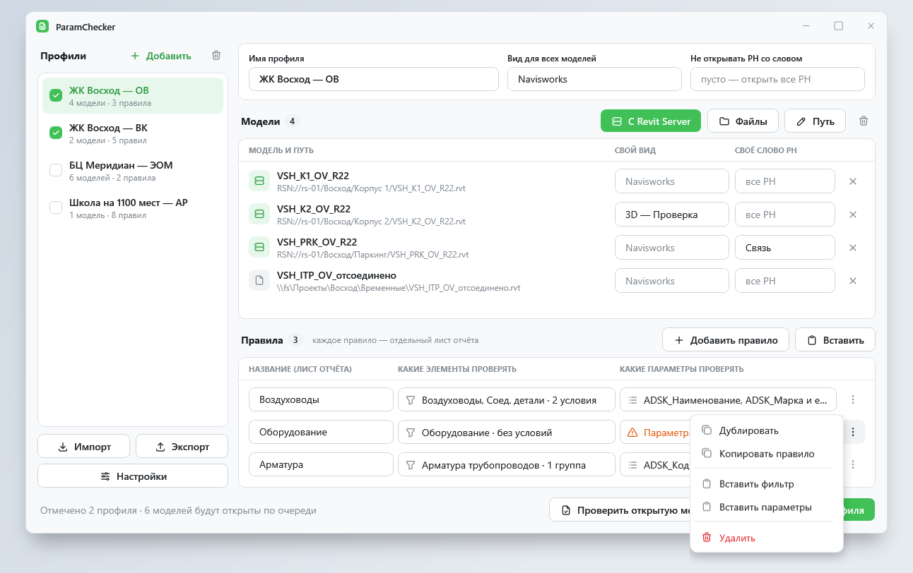

<p align="center">
    
    <h1 align="center">ToadDesign</h1>
    <p align="center">Контролы и стили WPF для окон плагинов Autodesk Revit 2020–2027</p>
</p>

ToadDesign — оформление WPF в стиле [ToadFlow](https://github.com/Alexpivo394/ToadFlow): светлая и тёмная темы, зелёный акцент, своё окно, кнопки, поля, карточки и 5184 иконки [Tabler](https://tabler.io/icons). Сделана для окон, которые живут внутри чужого приложения, — прежде всего плагинов Revit.

<p align="center">
    
</p>

Подробности и примеры — в [вики](https://github.com/Alexpivo394/ToadDesign/wiki).

## Возможности

- **Одинаково на Windows 10 и 11** — своя рамка окна, скруглённые углы, тень и заголовок.
- **Не трогает чужое** — оформление действует только внутри ваших окон и панелей; `Application.Current`, интерфейс Revit и других плагинов не меняются.
- **Темы на лету** — `ToadTheme.Mode = ToadThemeMode.Dark` перекрашивает все открытые окна, в том числе в других потоках; режим `System` следует настройке Windows.
- **Стандартные контролы WPF оформлены сами** — кнопки, флажки, выпадающие списки, `ListView`, `TreeView`, `DataGrid`, меню, подсказки, полосы прокрутки.
- **Свои контролы** — `ToadWindow`, `Button` с вариантами и цветами, `TextBox` с подсказкой и иконкой, `PasswordBox` с привязкой пароля, `AutoSuggestBox`, `Switch`, `Card`, `CardExpander`, `Alert`, `Badge`, `Loader`, `Icon`.
- **Без зависимостей** — одна сборка под `net47` (Revit 2020–2024) и `net8.0-windows` (Revit 2025–2027); вшивается в сборку плагина ILRepack.

## Установка

```xml
<PackageReference Include="Alexpivo394.ToadDesign" Version="1.0.0" />
```

Пакет — [`Alexpivo394.ToadDesign`](https://www.nuget.org/packages/Alexpivo394.ToadDesign) на nuget.org.

## Первое окно

```xml
<toad:ToadWindow x:Class="MyAddin.Views.DashWindow"
                 xmlns="http://schemas.microsoft.com/winfx/2006/xaml/presentation"
                 xmlns:x="http://schemas.microsoft.com/winfx/2006/xaml"
                 xmlns:toad="urn:toaddesign"
                 Title="Записать прочерк" TitleIcon="Minus" Width="460" Height="470">
    <DockPanel Margin="20,6,20,18">
        <toad:TextBox DockPanel.Dock="Top" Placeholder="Поиск параметров..." Icon="Search" />
        <toad:Button DockPanel.Dock="Bottom" HorizontalAlignment="Right" Margin="0,14,0,0"
                     Variant="Filled" Icon="Rocket" Content="Запуск" />
        <ListBox Margin="0,12,0,0" ItemsSource="{Binding Parameters}" />
    </DockPanel>
</toad:ToadWindow>
```

```csharp
ToadTheme.Mode = ToadThemeMode.Dark;
```

Для `UserControl` и `Page` (закрепляемая панель Revit) — `toad:Theme.IsRoot="True"` на корне. Подробнее — [Начало работы](https://github.com/Alexpivo394/ToadDesign/wiki/GettingStarted).

## Разработка

Нужны .NET 10 SDK и .NET Framework 4.7 Targeting Pack.

| Папка | Что там |
|---|---|
| `src/ToadDesign` | Библиотека |
| `src/ToadDesign.Gallery` | Галерея: все контролы во всех состояниях и окна-образцы |
| `tests/ToadDesign.Tests` | Проверки без Revit |
| `tools/IconGen` | Генератор иконок из `@tabler/icons` |
| `wiki` | Вики; публикуется в GitHub Wiki при изменении в `main` |

```bash
dotnet build ToadDesign.slnx
sh tests/run.sh
```

## Лицензия

MIT. Иконки — [Tabler Icons](https://tabler.io/icons), MIT.
