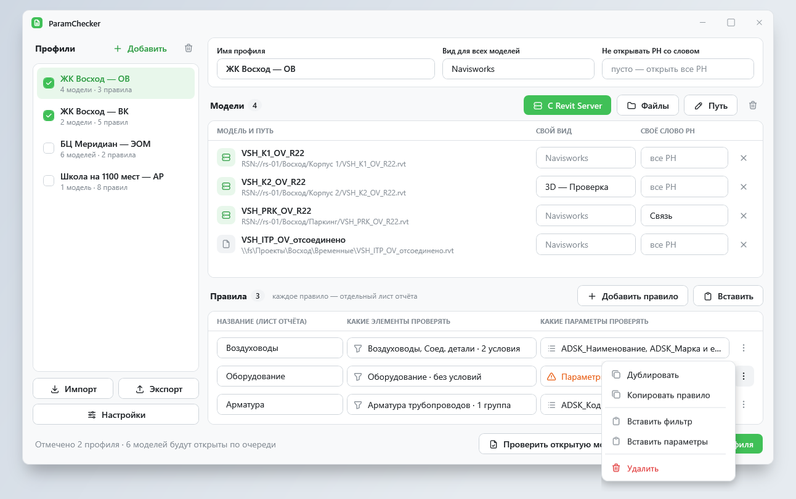
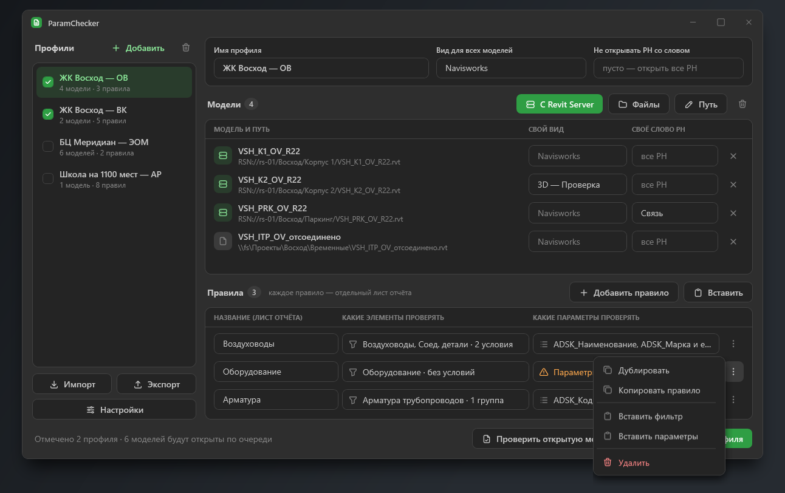
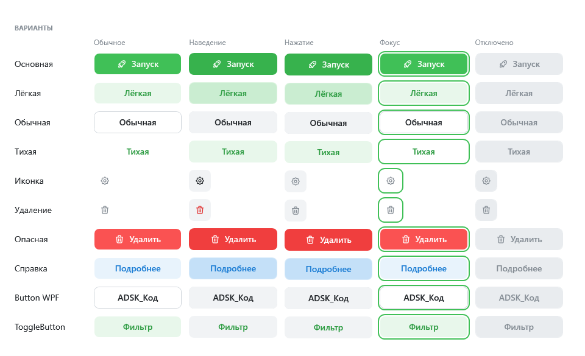

<p align="center">
  
</p>

<h1 align="center">ToadDesign</h1>

<p align="center">
  Контролы и стили WPF для окон, которые живут внутри чужого приложения.<br>
  Прежде всего — для плагинов Autodesk Revit 2020–2027.
</p>

<p align="center">
  <a href="https://www.nuget.org/packages/Alexpivo394.ToadDesign"></a>
  <a href="https://www.nuget.org/packages/Alexpivo394.ToadDesign"></a>
  <a href="https://github.com/Alexpivo394/ToadDesign/actions/workflows/Build.yml"></a>
  <a href="https://github.com/Alexpivo394/ToadDesign/blob/main/LICENSE.md"></a>
</p>

<p align="center">
  <b><a href="https://github.com/Alexpivo394/ToadDesign/wiki/GettingStarted">Начало работы</a></b> ·
  <a href="https://github.com/Alexpivo394/ToadDesign/wiki/Controls">Контролы</a> ·
  <a href="https://github.com/Alexpivo394/ToadDesign/wiki/Icons">Иконки</a> ·
  <a href="https://github.com/Alexpivo394/ToadDesign/wiki/Revit">Плагины Revit</a>
</p>

---

| Светлая тема | Тёмная тема |
|---|---|
|  |  |

## Зачем ещё одна библиотека

Библиотеки оформления WPF рассчитаны на своё приложение: стили кладутся в `Application.Current`, тема одна на процесс. В плагине приложение чужое. Там уже есть интерфейс Revit и окна других плагинов, а до Revit 2027 все плагины ещё и грузятся в один контекст, где две версии одной библиотеки мешают друг другу.

ToadDesign сделана под эти условия:

- **Не трогает чужое.** Оформление действует только внутри ваших окон и панелей. `Application.Current`, интерфейс Revit и другие плагины не меняются.
- **Одинакова на Windows 10 и 11.** Своя рамка окна, скруглённые углы, тень и заголовок.
- **Меняет тему на лету.** `ToadTheme.Mode = ToadThemeMode.Dark` перекрашивает все открытые окна, в том числе в других потоках. Режим `System` следует настройке Windows.
- **Бывает плотной.** `ToadTheme.Density = ToadDensity.Compact` уменьшает шрифты, высоту контролов и отступы во всех открытых окнах; окно не открывается больше рабочей области монитора.
- **Оформляет стандартные контролы WPF.** Кнопки, флажки, выпадающие списки, `ListView`, `TreeView`, `DataGrid`, меню, подсказки и полосы прокрутки внутри окна выглядят как надо без правки разметки.
- **Не тянет зависимостей.** Одна сборка, которая вшивается в сборку плагина ILRepack. У каждой вшитой копии своя тема.

## Что внутри

Свои контролы: `ToadWindow`, `Button` с вариантами и цветами, `TextBox` с подсказкой и иконкой, `PasswordBox` с привязкой пароля, `AutoSuggestBox`, `Switch`, `Card`, `CardExpander`, `Alert`, `Badge`, `Loader` и `Icon` с 5184 иконками [Tabler](https://tabler.io/icons).

<p align="center">
  
</p>

Остальные контролы во всех состояниях — на странице [«Контролы»](https://github.com/Alexpivo394/ToadDesign/wiki/Controls).

## Установка

```xml
<PackageReference Include="Alexpivo394.ToadDesign" Version="1.1.0" />
```

| Revit | Сборка пакета |
|---|---|
| 2020–2024 | `net47` |
| 2025–2027 | `net8.0-windows` |

## Первое окно

```xml
<toad:ToadWindow x:Class="MyAddin.Views.DashWindow"
                 xmlns="http://schemas.microsoft.com/winfx/2006/xaml/presentation"
                 xmlns:x="http://schemas.microsoft.com/winfx/2006/xaml"
                 xmlns:toad="urn:toaddesign"
                 Title="Записать прочерк" TitleIcon="Minus" Width="460" Height="470">
    <DockPanel Margin="20,6,20,18">
        <toad:TextBox DockPanel.Dock="Top" Placeholder="Поиск параметров..." Icon="Search" />
        <toad:Button DockPanel.Dock="Bottom" HorizontalAlignment="Right" Margin="0,14,0,0"
                     Variant="Filled" Icon="Rocket" Content="Запуск" />
        <ListBox Margin="0,12,0,0" ItemsSource="{Binding Parameters}" />
    </DockPanel>
</toad:ToadWindow>
```

Тема переключается одной строкой:

```csharp
ToadTheme.Mode = ToadThemeMode.Dark;
```

Для `UserControl` и `Page`, например закрепляемой панели Revit, поставьте на корень `toad:Theme.IsRoot="True"`.

## В плагине Revit

До Revit 2027 вшивайте библиотеку в сборку плагина. Ключи `/copyattrs /allowMultiple` обязательны: без них пропадает пространство имён `urn:toaddesign`.

```
ILRepack /union /illink /parallel /copyattrs /allowMultiple /out:MyAddin.dll MyAddin.dll ToadDesign.dll
```

Окна в отдельных потоках и другие подробности — на странице [«Плагины Revit»](https://github.com/Alexpivo394/ToadDesign/wiki/Revit).

## Разработка

Нужны .NET 10 SDK и .NET Framework 4.7 Targeting Pack.

```powershell
dotnet build ToadDesign.slnx
sh tests/run.sh                                               # проверки под net47 и net8, обычные и вшитые ILRepack
dotnet run --project src/ToadDesign.Gallery -f net8.0-windows # галерея всех контролов
```

| Папка | Что там |
|---|---|
| `src/ToadDesign` | Библиотека |
| `src/ToadDesign.Gallery` | Галерея: все контролы во всех состояниях и окна-образцы |
| `tests/ToadDesign.Tests` | Проверки без Revit |
| `tools/IconGen` | Генератор иконок из `@tabler/icons` |
| `wiki` | Вики; из `main` публикуется на GitHub сама |

Снимки в этом файле и в вики делает сама галерея. Подробнее — на странице [«Разработка»](https://github.com/Alexpivo394/ToadDesign/wiki/Development).

## Лицензия

[MIT](https://github.com/Alexpivo394/ToadDesign/blob/main/LICENSE.md). Иконки — [Tabler Icons](https://tabler.io/icons), тоже MIT.
