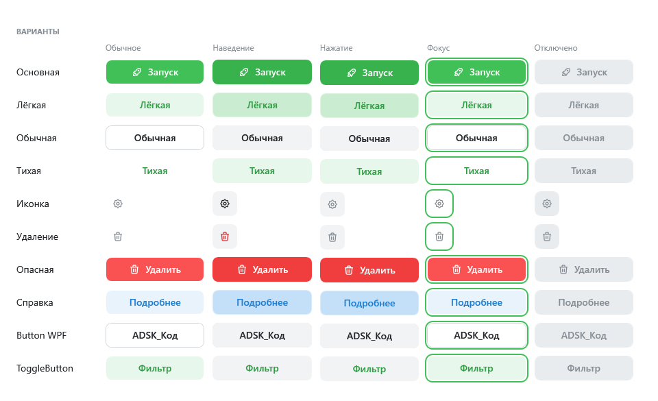
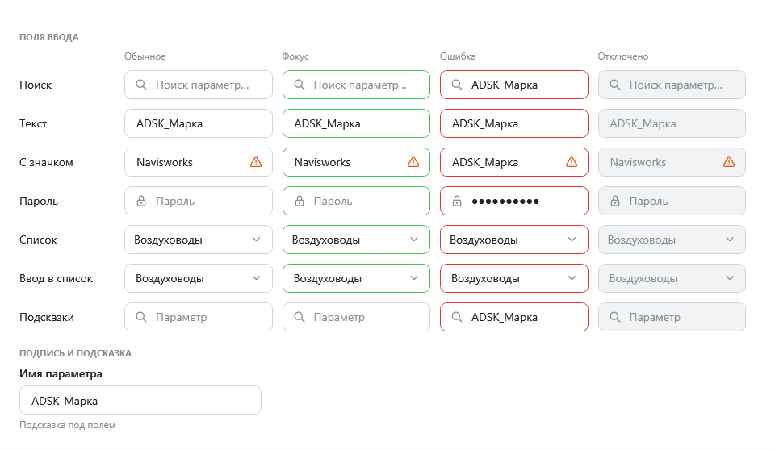
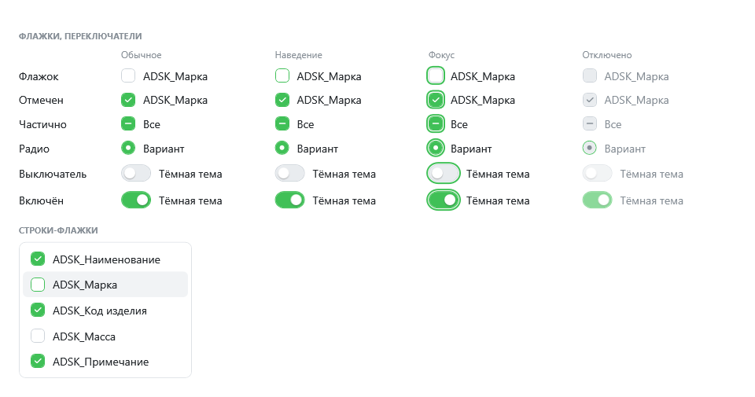
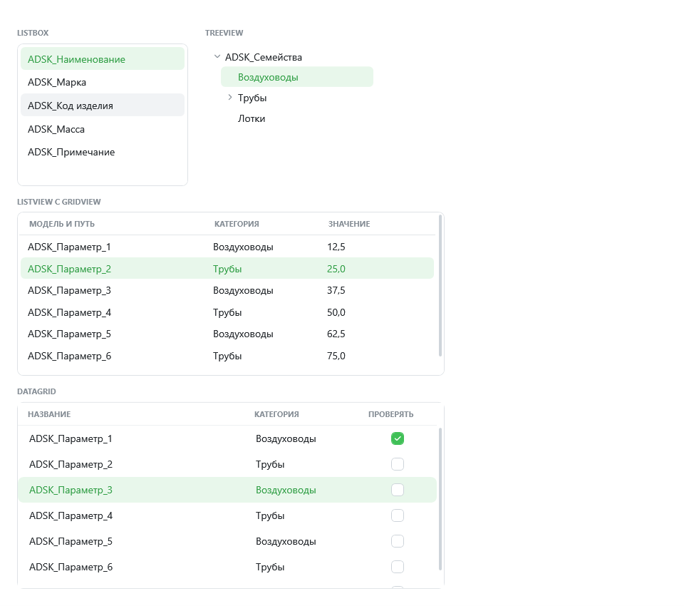
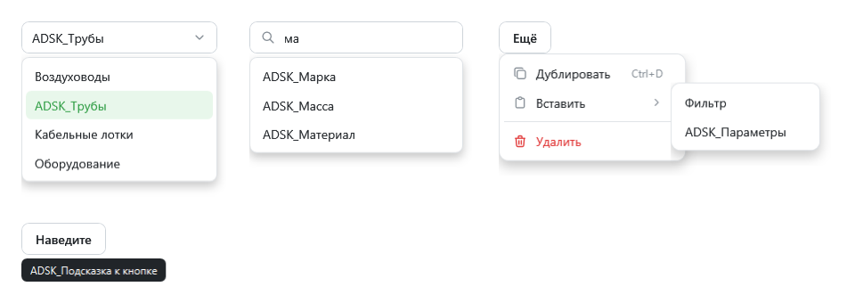
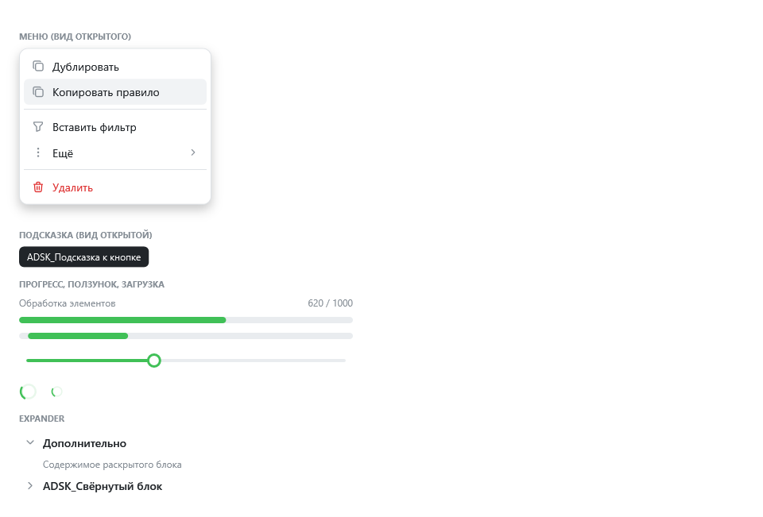
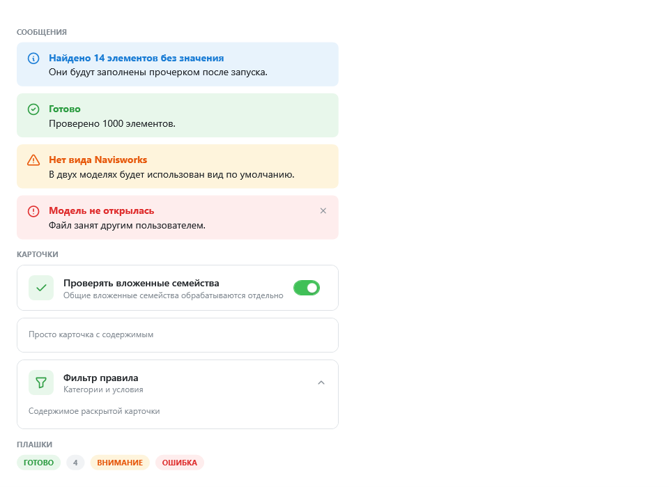

# Контролы

Внутри окна или панели ToadDesign стандартные контролы WPF оформлены сами: `Button`, `ToggleButton`, `CheckBox`, `RadioButton`, `ComboBox`, `TextBox`, `PasswordBox`, `ListBox`, `ListView`, `TreeView`, `DataGrid`, полосы прокрутки, `ContextMenu`, `ToolTip`, `ProgressBar`, `Slider`, `Expander`, `GridSplitter`, `Separator`. Свои контролы ниже добавляют то, чего в WPF нет.

У каждого контрола отрисованы состояния: обычное, наведение, нажатие, фокус с клавиатуры, отключено; у полей — ошибка проверки. Знак `_` в подписях (`ADSK_Марка`) показывается как есть.

## Кнопки



```xml
<toad:Button Variant="Filled" Icon="Rocket" Content="Запуск" />
<toad:Button Content="Отмена" />
<toad:Button Variant="Subtle" Icon="Plus" Content="Добавить" />
<toad:Button Icon="Trash" Tone="Danger" ToolTip="Удалить" />
<toad:Button Variant="Filled" Tone="Danger" Icon="Trash" Content="Удалить" />
```

| Свойство | Значения |
|---|---|
| `Variant` | `Default` — обычная с рамкой; `Filled` — заливка; `Light` — светлый фон; `Subtle` — без фона до наведения |
| `Tone` | `Accent` (по умолчанию), `Neutral`, `Info`, `Warning`, `Danger` |
| `Icon` | Иконка слева от текста. Без `Content` кнопка квадратная, только с иконкой |

Обычный `Button` выглядит как `Variant="Default"`.

## Поля



```xml
<toad:TextBox Placeholder="Поиск параметров..." Icon="Search" Text="{Binding Query}" />
<toad:TextBox Text="{Binding Name}">
    <toad:TextBox.TrailingContent>
        <toad:Icon Symbol="AlertTriangle" Foreground="{DynamicResource Toad.Brush.Warning}" />
    </toad:TextBox.TrailingContent>
</toad:TextBox>
<toad:PasswordBox Placeholder="Пароль" Icon="Lock" Password="{Binding Password}" />
<toad:AutoSuggestBox Placeholder="Параметр" ItemsSource="{Binding AllParameters}"
                     SuggestionChosen="OnParameterChosen" />
```

- `toad:TextBox` — подсказка в пустом поле (`Placeholder`), иконка слева (`Icon`), место справа (`TrailingContent`).
- `toad:PasswordBox` — пароль с привязкой `Password`.
- `toad:AutoSuggestBox` — поле с выпадающими подсказками: показывает элементы `ItemsSource`, в тексте которых есть набранное. Стрелки — выбор, `Enter` или щелчок — подтвердить, `Esc` — закрыть. Для объектов — `DisplayMemberPath` (можно путь: `Home.City`). Выбор — событие `SuggestionChosen`, выбранный элемент в `e.Item`.
- Ошибка проверки привязки окрашивает рамку в красный, без стандартного красного прямоугольника WPF.

## Флажки и переключатели



```xml
<CheckBox Content="ADSK_Марка" IsChecked="{Binding IsSelected}" />
<CheckBox Content="Все" IsThreeState="True" />
<toad:Switch Content="Тёмная тема" IsChecked="{Binding IsDark}" />
<CheckBox Style="{DynamicResource Toad.Style.CheckBoxRow}" Content="ADSK_Масса" />
```

`Toad.Style.CheckBoxRow` — флажок-строка списка: отступы и подсветка при наведении на всю строку.

## Списки и таблицы



`ListBox`, `ListView` с `GridView`, `TreeView` и `DataGrid` оформлены без изменений разметки. Заголовки колонок — заглавными, приглушённые. В `DataGrid` нет линий сетки, выбранная строка — светлый акцент, флажки в `DataGridCheckBoxColumn` — в стиле ToadDesign.

## Меню, подсказки, прогресс



```xml
<toad:Button Icon="DotsVertical">
    <toad:Button.ContextMenu>
        <ContextMenu>
            <MenuItem Header="Дублировать" InputGestureText="Ctrl+D">
                <MenuItem.Icon><toad:Icon Symbol="Copy" /></MenuItem.Icon>
            </MenuItem>
            <Separator />
            <MenuItem Header="Удалить" toad:Theme.Tone="Danger">
                <MenuItem.Icon><toad:Icon Symbol="Trash" /></MenuItem.Icon>
            </MenuItem>
        </ContextMenu>
    </toad:Button.ContextMenu>
</toad:Button>
```



- `ProgressBar` — тонкая полоса; `IsIndeterminate="True"` — бегущий отрезок.
- `toad:Loader` — крутящийся индикатор, `IsActive="False"` прячет его.
- `ToolTip` — тёмная подсказка в светлой теме и светлая в тёмной.

## Карточки, сообщения, плашки



```xml
<toad:Alert Severity="Info" Title="Найдено 14 элементов без значения"
            Content="Они будут заполнены прочерком после запуска." />
<toad:Alert Severity="Error" Title="Модель не открылась" IsClosable="True" IsOpen="{Binding ShowError}" />

<toad:Card Icon="Check" Header="Проверять вложенные семейства"
           Description="Общие вложенные семейства обрабатываются отдельно">
    <toad:Card.TrailingContent>
        <toad:Switch IsChecked="{Binding CheckNested}" />
    </toad:Card.TrailingContent>
</toad:Card>

<toad:CardExpander Icon="Filter" Header="Фильтр правила" Description="Категории и условия">
    ...
</toad:CardExpander>

<toad:Badge Content="Готово" />
<toad:Badge Content="4" Tone="Neutral" />
```

- `Alert` — `Severity`: `Info`, `Success`, `Warning`, `Error`; `Title`, текст в `Content`, `IsClosable`, `IsOpen`, событие `Closed`.
- `Card` — рамка с фоном. С `Header` появляется строка заголовка: иконка на плашке (`Icon`), заголовок, `Description` под ним и `TrailingContent` справа; содержимое — ниже.
- `CardExpander` — то же, содержимое раскрывается по щелчку.
- `Badge` — плашка-метка, текст заглавными; `Tone` как у кнопок.

## Состояния без мыши

`toad:Theme.PreviewState="Hover"`, `"Pressed"` или `"Focus"` показывает состояние без мыши и фокуса — для галерей и документации. Поведение не меняется.
