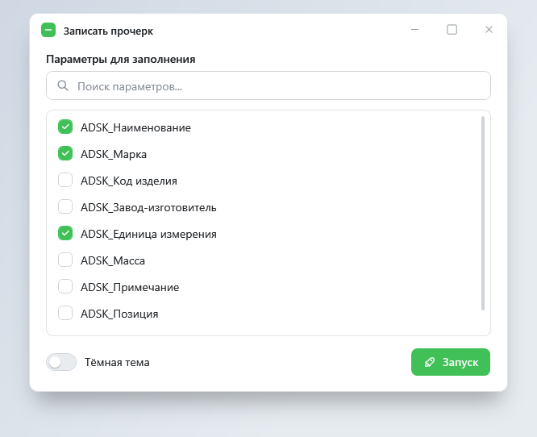
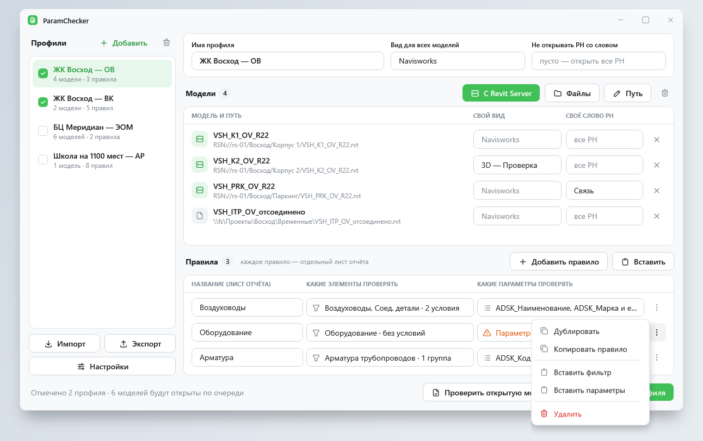

# ToadDesign — контролы и стили WPF для окон плагинов

**ToadDesign** — библиотека оформления WPF в стиле [ToadFlow](https://github.com/Alexpivo394/ToadFlow): светлая и тёмная темы на палитре Mantine, зелёный акцент, свои окна, кнопки, поля, карточки и 5184 иконки Tabler. Сделана для окон, которые живут внутри чужого приложения, прежде всего плагинов Autodesk Revit 2020–2027.

## Что умеет

- **Выглядит одинаково** на Windows 10 и 11: своя рамка окна, скруглённые углы, тень, заголовок.
- **Не трогает чужое.** Оформление действует только внутри вашего окна или панели. `Application.Current` не используется, стили Revit и других плагинов не меняются.
- **Две темы и акцент.** `ToadTheme.Mode = ToadThemeMode.Dark` перекрашивает все открытые окна, даже в разных потоках. Режим `System` следует настройке Windows.
- **Стандартные контролы WPF** — кнопки, флажки, списки, таблицы, меню, полосы прокрутки — внутри окна получают оформление сами, менять разметку не нужно.
- **Без зависимостей.** Одна сборка под `net47` (Revit 2020–2024) и `net8.0-windows` (Revit 2025–2027).

## Страницы

| Страница | О чём |
|---|---|
| [Начало работы](GettingStarted) | Подключение пакета и первое окно |
| [Тема и цвета](Theme) | Светлая, тёмная, системная тема, акцент, цвета и размеры |
| [Окно](Window) | `ToadWindow`: заголовок, кнопки, фон, размеры, тень |
| [Контролы](Controls) | Кнопки, поля, флажки, списки, таблицы, меню, карточки, сообщения |
| [Иконки](Icons) | `toad:Icon` и 5184 иконки Tabler |
| [Плагины Revit](Revit) | Потоки, вшивание ILRepack, несколько плагинов в одном Revit |
| [Разработка](Development) | Галерея, проверки, генератор иконок |

