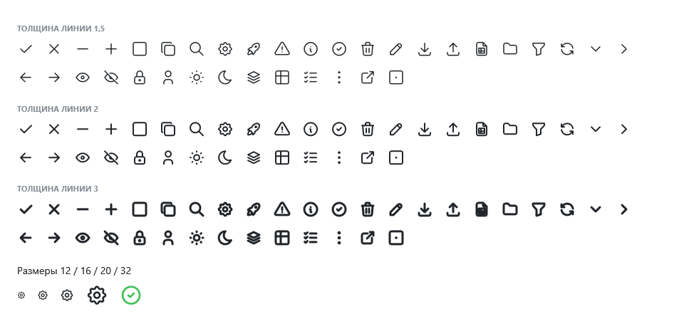

# Иконки

Все 5184 контурные иконки [Tabler Icons](https://tabler.io/icons) — те же, что в ToadFlow. Найдите иконку на tabler.io, имя переведите в PascalCase: `alert-triangle` → `AlertTriangle`, `player-play` → `PlayerPlay`, имя с цифры получает приставку `Number`: `123` → `Number123`.



```xml
<toad:Icon Symbol="Settings" />
<toad:Icon Symbol="CircleCheck" Width="32" Height="32" Foreground="{DynamicResource Toad.Brush.Accent}" />
<toad:Icon Symbol="X" StrokeThickness="1.5" />
```

| Свойство | Что делает |
|---|---|
| `Symbol` | Иконка |
| `StrokeThickness` | Толщина линии в единицах иконки 24×24, как `stroke-width` в SVG; по умолчанию 2 |
| `Foreground` | Цвет; по умолчанию наследуется, как цвет текста |
| `Width`, `Height` | Размер; по умолчанию 16, и в большем месте иконка не растягивается |

Иконки рисуются линиями, а не шрифтом: толщина меняется, а значения `Symbol` не меняются между версиями пакета.

У кнопок, полей, карточек и заголовка окна иконка задаётся свойством `Icon` (`TitleIcon` у окна).
