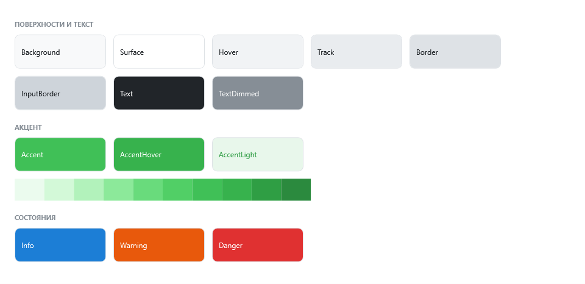
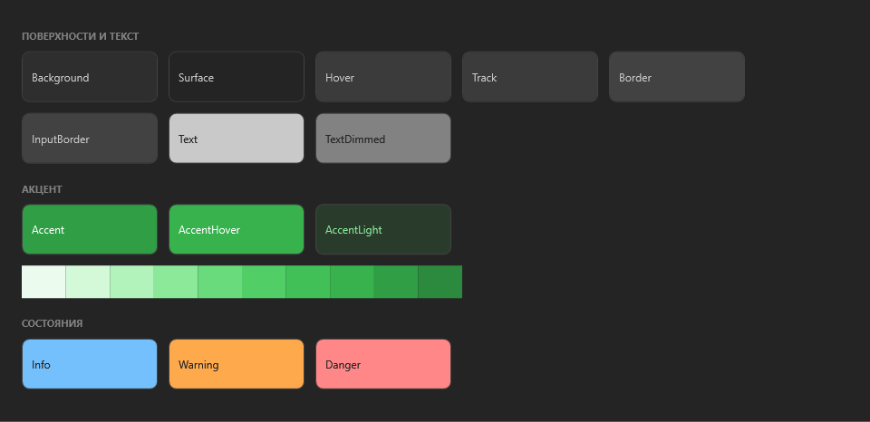
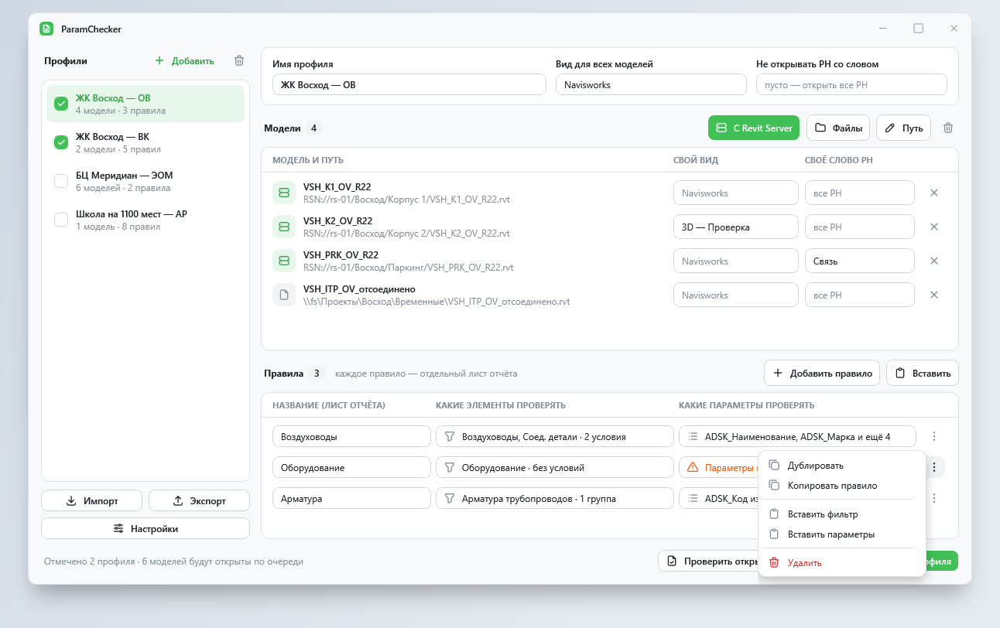

# Тема и цвета

## Режим

```csharp
ToadTheme.Mode = ToadThemeMode.Dark;   // Light, Dark или System
```

- Смена режима перекрашивает **все открытые окна и панели** этого плагина, каждое в своём потоке — в том числе окно прогресса в отдельном потоке.
- `System` следует настройке Windows «Режим приложений» и меняется вместе с ней.
- `ToadTheme.ActualMode` — действующий режим: `Light` или `Dark`, с уже разрешённым `System`.

Кто и где выбирает тему — переключатель в окне, настройка плагина — решает плагин.




## Акцент

По умолчанию — зелёный ToadFlow. Свой акцент — шкала из 10 оттенков, от светлого к тёмному, как цвет в Mantine:

```csharp
ToadTheme.Accent = new AccentScale(
    Color.FromRgb(0xe7, 0xf5, 0xff), /* … ещё 8 оттенков … */ Color.FromRgb(0x18, 0x64, 0xab));
```

Заливка кнопок — оттенок 6 в светлой теме и 8 в тёмной, наведение — 7.

## Цвета для своей разметки

Всегда через `DynamicResource` — тогда цвет меняется вместе с темой.

| Ключ | Светлая | Тёмная | Для чего |
|---|---|---|---|
| `Toad.Brush.Surface` | `#ffffff` | `#242424` | Карточки, поля, меню, простое окно |
| `Toad.Brush.Background` | `#f8f9fa` | `#2e2e2e` | Окно с карточками |
| `Toad.Brush.Text` | `#212529` | `#c9c9c9` | Текст |
| `Toad.Brush.TextDimmed` | `#868e96` | `#828282` | Подписи, подсказки |
| `Toad.Brush.Border` | `#dee2e6` | `#424242` | Рамки карточек и окна |
| `Toad.Brush.InputBorder` | `#ced4da` | `#424242` | Рамки полей |
| `Toad.Brush.Hover` | `#f1f3f5` | `#3b3b3b` | Фон при наведении |
| `Toad.Brush.Accent` | `#40c057` | `#2f9e44` | Акцент |
| `Toad.Brush.AccentLight` / `AccentLightText` | | | Лёгкий акцент: фон и текст |
| `Toad.Brush.Info`, `Warning`, `Danger` | | | Справка, предупреждение, ошибка |
| `Toad.Brush.InfoLight`, `WarningLight`, `DangerLight` | | | Их светлые фоны |

```xml
<TextBlock Text="Отметьте параметры" Foreground="{DynamicResource Toad.Brush.TextDimmed}" />
<Border Background="{DynamicResource Toad.Brush.Surface}" BorderBrush="{DynamicResource Toad.Brush.Border}" />
```

У каждой кисти есть цвет с тем же именем: `Toad.Color.Accent` и т. д.

## Плотность

```csharp
ToadTheme.Density = ToadDensity.Compact;   // Normal (по умолчанию) или Compact
```

Компактная плотность уменьшает шрифты, высоту кнопок, полей и заголовка окна и внутренние отступы — для окон с большим числом элементов и небольших экранов. Смена плотности пересчитывает **все открытые окна и панели** этого плагина, как и смена режима. Тема и плотность не зависят друг от друга. Кто и где выбирает плотность — настройка плагина — решает плагин.




Слева — `Normal`, справа — `Compact`.

## Размеры и шрифт

Шрифт и радиусы от плотности не зависят:

| Ключ | Значение |
|---|---|
| `Toad.FontFamily` | Segoe UI |
| `Toad.Radius.Window` / `Control` / `Item` | 10 / 8 / 6 |

Размеры, зависящие от плотности:

| Ключ | Normal | Compact | Для чего |
|---|---|---|---|
| `Toad.FontSize` | 14 | 12 | Основной текст |
| `Toad.FontSize.Small` | 12 | 11 | Мелкий текст |
| `Toad.FontSize.Caption` | 11 | 10 | Подписи |
| `Toad.FontSize.Title` | 13 | 12 | Название в заголовке окна |
| `Toad.FontSize.Heading` | 18 | 15 | Заголовки |
| `Toad.Size.Control` | 36 | 28 | Высота кнопок и полей |
| `Toad.Size.TitleBar` | 40 | 32 | Высота заголовка окна |

Отступы (`Thickness`, «16,0» — по горизонтали и вертикали):

| Ключ | Normal | Compact |
|---|---|---|
| `Toad.Padding.Button` | 16,0 | 10,0 |
| `Toad.Padding.Field` | 12,0 | 8,0 |
| `Toad.Padding.Item` | 10,7 | 7,5 |
| `Toad.Padding.Tab` | 14,8 | 10,6 |
| `Toad.Padding.Cell` | 14,0 | 10,0 |
| `Toad.Padding.Header` | 14,8 | 10,6 |
| `Toad.Padding.Row` | 4,6 | 3,5 |
| `Toad.Padding.TreeItem` | 4,5 | 3,5 |
| `Toad.Padding.Tip` | 10,5 | 7,4 |
| `Toad.Padding.Card` | 16,14 | 11,9 |
| `Toad.Padding.CardHeader` | 16,14 | 11,9 |
| `Toad.Padding.CardBody` | 16,0,16,14 | 11,0,11,9 |
| `Toad.Padding.Alert` | 14,12 | 10,8 |
| `Toad.Padding.ExpanderHeader` | 6 | 5 |

В своей разметке берите размеры из ресурсов — тогда они следуют плотности:

```xml
<TextBlock Text="Подпись" FontSize="{DynamicResource Toad.FontSize.Small}" />
<Border Height="{DynamicResource Toad.Size.Control}" Padding="{DynamicResource Toad.Padding.Field}" />
```

Плотное окно только в одном месте — переопределите ключ в ресурсах окна, например кнопки и поля по 34:

```xml
<toad:ToadWindow.Resources>
    <sys:Double x:Key="Toad.Size.Control" xmlns:sys="clr-namespace:System;assembly=mscorlib">34</sys:Double>
</toad:ToadWindow.Resources>
```
