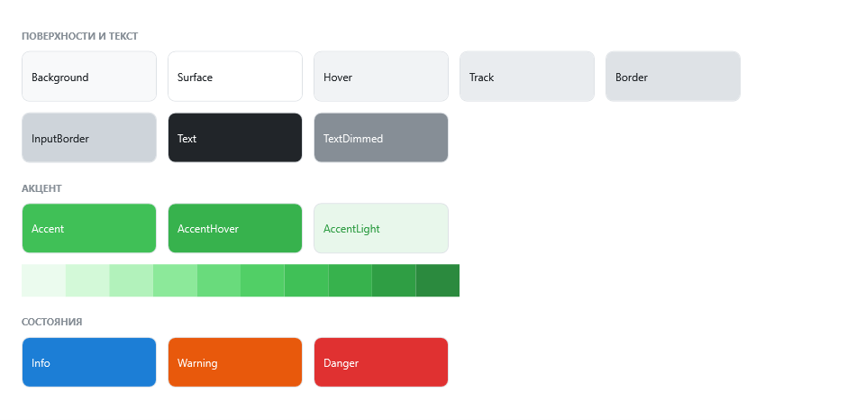
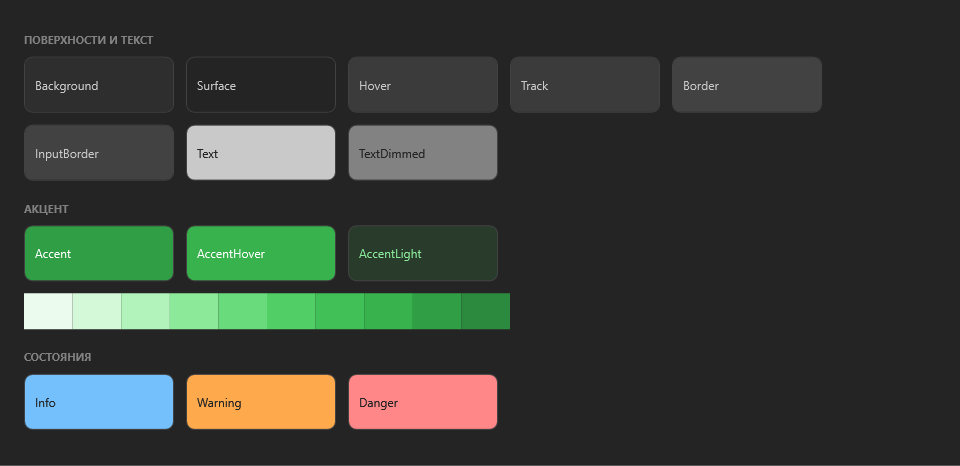

# Тема и цвета

## Режим

```csharp
ToadTheme.Mode = ToadThemeMode.Dark;   // Light, Dark или System
```

- Смена режима перекрашивает **все открытые окна и панели** этого плагина, каждое в своём потоке — в том числе окно прогресса в отдельном потоке.
- `System` следует настройке Windows «Режим приложений» и меняется вместе с ней.
- `ToadTheme.ActualMode` — действующий режим: `Light` или `Dark`, с уже разрешённым `System`.

Кто и где выбирает тему — переключатель в окне, настройка плагина — решает плагин.




## Акцент

По умолчанию — зелёный ToadFlow. Свой акцент — шкала из 10 оттенков, от светлого к тёмному, как цвет в Mantine:

```csharp
ToadTheme.Accent = new AccentScale(
    Color.FromRgb(0xe7, 0xf5, 0xff), /* … ещё 8 оттенков … */ Color.FromRgb(0x18, 0x64, 0xab));
```

Заливка кнопок — оттенок 6 в светлой теме и 8 в тёмной, наведение — 7.

## Цвета для своей разметки

Всегда через `DynamicResource` — тогда цвет меняется вместе с темой.

| Ключ | Светлая | Тёмная | Для чего |
|---|---|---|---|
| `Toad.Brush.Surface` | `#ffffff` | `#242424` | Карточки, поля, меню, простое окно |
| `Toad.Brush.Background` | `#f8f9fa` | `#2e2e2e` | Окно с карточками |
| `Toad.Brush.Text` | `#212529` | `#c9c9c9` | Текст |
| `Toad.Brush.TextDimmed` | `#868e96` | `#828282` | Подписи, подсказки |
| `Toad.Brush.Border` | `#dee2e6` | `#424242` | Рамки карточек и окна |
| `Toad.Brush.InputBorder` | `#ced4da` | `#424242` | Рамки полей |
| `Toad.Brush.Hover` | `#f1f3f5` | `#3b3b3b` | Фон при наведении |
| `Toad.Brush.Accent` | `#40c057` | `#2f9e44` | Акцент |
| `Toad.Brush.AccentLight` / `AccentLightText` | | | Лёгкий акцент: фон и текст |
| `Toad.Brush.Info`, `Warning`, `Danger` | | | Справка, предупреждение, ошибка |
| `Toad.Brush.InfoLight`, `WarningLight`, `DangerLight` | | | Их светлые фоны |

```xml
<TextBlock Text="Отметьте параметры" Foreground="{DynamicResource Toad.Brush.TextDimmed}" />
<Border Background="{DynamicResource Toad.Brush.Surface}" BorderBrush="{DynamicResource Toad.Brush.Border}" />
```

У каждой кисти есть цвет с тем же именем: `Toad.Color.Accent` и т. д.

## Размеры и шрифт

| Ключ | Значение |
|---|---|
| `Toad.FontFamily` | Segoe UI |
| `Toad.FontSize` / `Small` / `Caption` | 14 / 12 / 11 |
| `Toad.Size.Control` | 36 — высота кнопок и полей |
| `Toad.Radius.Window` / `Control` / `Item` | 10 / 8 / 6 |

Плотное окно — кнопки и поля по 34, как в больших окнах ParamChecker:

```xml
<toad:ToadWindow.Resources>
    <sys:Double x:Key="Toad.Size.Control" xmlns:sys="clr-namespace:System;assembly=mscorlib">34</sys:Double>
</toad:ToadWindow.Resources>
```
