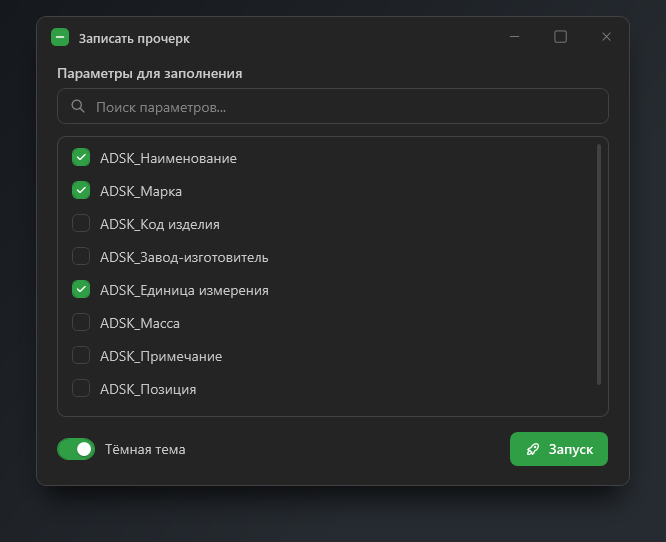
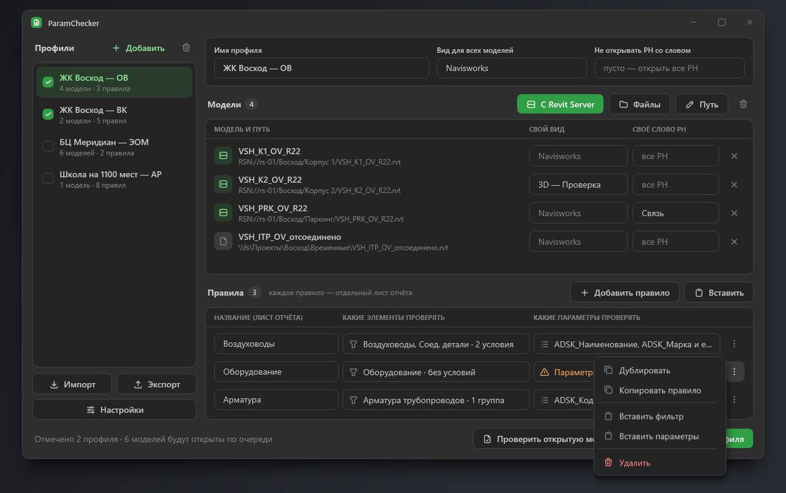

# Окно

`toad:ToadWindow` — окно со своим заголовком, скруглёнными углами и тенью. На Windows 10 и 11 выглядит одинаково.



## Свойства

| Свойство | Что делает |
|---|---|
| `Title` | Название в заголовке |
| `TitleIcon` | Иконка на зелёной плашке слева от названия; без неё плашки нет |
| `TitleBarContent` | Свои элементы в заголовке, между названием и кнопками — например, переключатель темы |
| `ShowMinimizeButton`, `ShowMaximizeButton`, `ShowCloseButton` | Показывать ли «свернуть», «развернуть» и «закрыть». Без «закрыть» — окно, которое пользователь закрыть не должен, например прогресс |
| `Fill` | `Surface` (по умолчанию) — простое окно; `Background` — окно на тон темнее, для раскладки карточками |

```xml
<toad:ToadWindow Title="ParamChecker" TitleIcon="FileDescription" Fill="Background"
                 Width="1220" Height="740" ShowMinimizeButton="False">
    <toad:ToadWindow.TitleBarContent>
        <toad:Button Icon="Moon" ToolTip="Тема" Command="{Binding ToggleThemeCommand}" />
    </toad:ToadWindow.TitleBarContent>
    ...
</toad:ToadWindow>
```



## Размеры и положение

- `Width`, `Height`, `Left`, `Top` — это **видимое** окно. Тень рисуется снаружи отдельными прозрачными окнами, которые пропускают клики.
- Поэтому сохранение и восстановление положения окна, `WindowStartupLocation`, `MinWidth`/`MaxWidth`, прилипание к краям экрана и разворот работают как у обычного окна.
- Развёрнутое окно занимает рабочую область монитора, без рамки и скругления.

## Поведение

Перетаскивание за заголовок, двойной щелчок для разворота, изменение размера за края, прилипание к краям, системное меню `Alt+Пробел` — как у обычного окна Windows.
